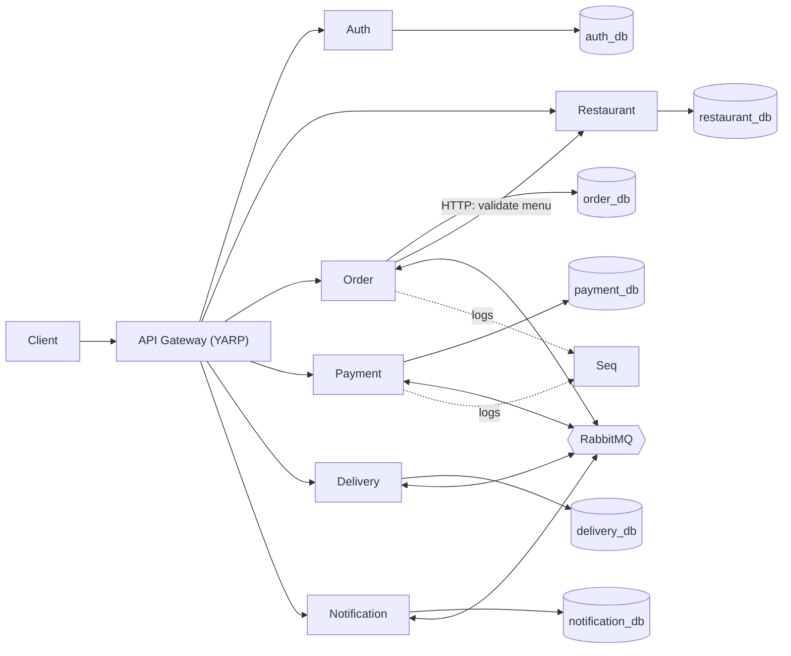
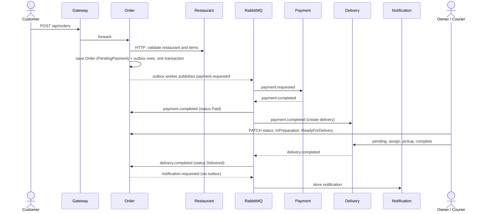

# FoodDelivery

[](https://github.com/KirilVenzhik/food-delivery-dyploma/actions/workflows/ci.yml)

A food delivery backend built as .NET 9 microservices: an API gateway, six services, RabbitMQ events and one PostgreSQL database per service.

## Overview

- **Customer** registers, browses restaurants and menus, places orders, and reads notifications about them.
- **RestaurantOwner** manages restaurants and menu items, opens or closes a restaurant, and moves orders through preparation.
- **Courier** sees deliveries that are ready, then assigns, picks up and completes them.

## Architecture



Every service writes logs to Seq (only two arrows are drawn). The gateway checks the JWT, and each service validates it again.

## Order flow (happy path)



The outbox also holds a `NotificationRequested` row written in the same transaction as the order. The outbox worker polls every 2 seconds. Payment is simulated and always completes.

## Services

| Service | Responsibility | DB | Docker port | Gateway prefix |
|---|---|---|---|---|
| ApiGateway (YARP) | Single entry point, JWT check, forwards `X-Correlation-Id` | - | 5000 | - |
| Auth | Register/login, JWT and refresh tokens, BCrypt | auth_db | 5262 | `/api/auth` |
| Restaurant | Restaurants, menu items, open/close | restaurant_db | 5265 | `/api/restaurants` |
| Order | Place orders, order state machine, transactional outbox | order_db | 5223 | `/api/orders` |
| Payment | Processes payment requests (simulated, always succeeds) | payment_db | 5045 | `/api/payments` |
| Delivery | Created on payment; courier assign, pickup, complete | delivery_db | 5085 | `/api/deliveries` |
| Notification | Stores user notifications built from events | notification_db | 5042 | `/api/notifications` |

Each service has API / Application / Domain / Infrastructure layers. Migrations are applied at startup.

## Key design decisions

- **Database per service** - services own their data and can change schema independently; cross-service data moves only through HTTP or events.
- **Event-driven choreography, no orchestrator** - each service reacts to events and publishes its own, so there is no central workflow service coupling everything.
- **Transactional outbox in Order** - the order and its outgoing events are saved in one transaction, so an order cannot be saved without its payment request.
- **Idempotent consumers** - RabbitMQ delivers at least once, so each consumer records handled event ids in a `ProcessedEvents` table and skips duplicates.
- **CQRS without MediatR** - `Commands/` and `Queries/` hold explicit handlers (18 command, 13 query) injected into controllers; easy to follow and debug, with no hidden pipeline.
- **JWT checked at the gateway and in every service** - the gateway rejects bad tokens early, and services still enforce roles (`Customer`, `RestaurantOwner`, `Courier`) if called directly.
- **Correlation id across HTTP and events** - `X-Correlation-Id` middleware and an event field let you follow one order through all services in Seq.

Messaging: a custom EventBus on RabbitMQ.Client 6.8.1 with one durable topic exchange `food-delivery.events` and a durable queue per consumer (`<service>.<event>`), manual ack, prefetch 1.

## Tech stack

.NET 9, ASP.NET Core Web API, EF Core 9 + Npgsql, PostgreSQL 16, RabbitMQ, YARP, JWT (HS256) + BCrypt, FluentValidation, Serilog + Seq, Docker Compose, xUnit + Moq + FluentAssertions, GitHub Actions. NuGet versions are managed centrally in `Directory.Packages.props`.

## Getting started

Prerequisites: Docker with Docker Compose.

```bash
cp .env.example .env     # then edit the values (DB, RabbitMQ, JWT secret)
docker compose up --build
```

| What | URL |
|---|---|
| Gateway | http://localhost:5000 |
| Swagger per service | `http://localhost:<service port>/swagger` (ports in the table above) |
| RabbitMQ management | http://localhost:15672 |
| Seq (logs) | http://localhost:8081 |

Every service and the gateway expose `GET /health`.

Smoke test through the gateway (`role` is numeric: 1 = Customer, 2 = RestaurantOwner, 3 = Courier):

```bash
curl -X POST http://localhost:5000/api/auth/register -H "Content-Type: application/json" \
  -d '{"email":"demo@example.com","password":"secret123","role":1}'

curl -X POST http://localhost:5000/api/auth/login -H "Content-Type: application/json" \
  -d '{"email":"demo@example.com","password":"secret123"}'
# copy "accessToken" from the response

curl http://localhost:5000/api/restaurants -H "Authorization: Bearer <accessToken>"
```

## Running tests

```bash
dotnet test FoodDelivery.sln
```

49 unit tests cover the Auth, Order, Payment and Restaurant services. CI runs the same build and tests on every push.

## Project structure

```text
src/
  ApiGateway/        YARP gateway
  BuildingBlocks/    Auth, Contracts (events), EventBus, Observability, Shared
  Services/          Auth, Restaurant, Order, Payment, Delivery, Notification
tests/               unit tests per service
docker-compose.yml   full stack: services, PostgreSQL x6, RabbitMQ, Seq
```

## Known limitations and next steps

These are known gaps. I would fix them next:

- **Open registration with any role** - `POST /api/auth/register` accepts any role in the request, including `Admin`. Roles should be assigned by an admin or an onboarding flow.
- **Missing ownership check** - changing an order status is limited to the `RestaurantOwner` role, but the handler does not check that the owner owns the order's restaurant.
- **Payment is simulated** - it always succeeds. The `PaymentFailed` consumer and domain logic exist in Order, but nothing publishes `PaymentFailed` yet.
- **Outbox only in Order** - Payment and Delivery publish right after saving, so a crash between the two steps can lose an event (dual-write risk).
- **No retry policy** - consumers requeue a message that fails processing, with no retry limit and no dead-letter queue.
- **New RabbitMQ connection per publish** - a shared connection or channel pool would be cheaper.
- **One shared symmetric JWT key** - asymmetric keys or an identity provider would be safer.
- **Tests** - unit tests only: no integration tests, and none for Delivery and Notification.
- **Configuration** - Swagger is enabled in all environments, and the Seq URL is hard-coded for the Docker network.

## About this project

This is my bachelor thesis at Odesa Polytechnic National University (2026). I built it with Claude Code as an AI pair programmer: I designed the architecture, split the work into tasks and reviewed every change.
